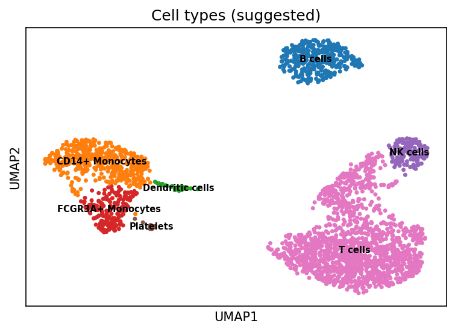

<div align="center">

# Cell-Atlas

[](CHANGELOG.md)
[](https://www.python.org/)
[](https://scanpy.readthedocs.io/)
[](https://github.com/rubenslyra/Cell-Atlas/actions/workflows/tests.yml)
[](LICENSE)
[](https://rubenslyra.github.io/Cell-Atlas/)

**Construção de um mapa celular por meio de análise de dados de sequenciamento de RNA de célula única**

*Sem dizer ao algoritmo o que procurar, 2.638 células do sangue se organizam em 7 tipos imunes conhecidos — com um único comando reprodutível.*

[Visão geral](#visão-geral) • [Instalação](#instalação) • [Execução](#execução) • [Resultados](#resultados) • [Arquitetura](#arquitetura) • [Apresentação e treino](#apresentação-e-treino) • [Desenvolvimento](#desenvolvimento) • [Referências](#referências)



</div>

---

## Visão geral

O **Cell-Atlas** é um pipeline Python para *single-cell RNA sequencing* (scRNA-seq): aquisição, controle de qualidade, normalização, redução dimensional, agrupamento Leiden, visualização UMAP e **anotação automática de tipos celulares** por genes marcadores.

O conjunto de referência é o **PBMC3k** (10x Genomics; Zheng et al., 2017): 2.700 células mononucleares do sangue periférico de um doador saudável, com 32.738 genes medidos por célula e nenhum rótulo.

| Indicador (execução de referência, `random_state=0`) | Valor |
| --- | --- |
| Células após controle de qualidade | 2.638 de 2.700 |
| Genes mantidos | 13.656 de 32.738 |
| Grupos Leiden (resolução 0,2 / 0,4 / **0,6** / 1,0) | 6 / 9 / **10** / 13 |
| Tipos imunes reencontrados | 7 |
| Concordância com rótulos de especialistas (`cellatlas compare`) | 96,8% (ARI 0,96) |
| Testes automatizados | 17 |

---

## Instalação

Pré-requisitos: Python ≥ 3.9 (testado até 3.14) e `pip` atualizado.

**Windows (PowerShell)**

```powershell
git clone https://github.com/rubenslyra/Cell-Atlas.git
cd Cell-Atlas
python -m venv .venv
.\.venv\Scripts\Activate.ps1
pip install -e ".[dev]"
```

**Linux / macOS**

```bash
git clone https://github.com/rubenslyra/Cell-Atlas.git
cd Cell-Atlas
python -m venv .venv && source .venv/bin/activate
pip install -e ".[dev]"
```

> `pip install -e .` instala o pacote e o comando `cellatlas`; `[dev]` acrescenta pytest, black, flake8 e mypy.
> Depois de alterar `pyproject.toml` (versão, dependências ou entry points), rode a instalação novamente.
> `requisitos.txt` continua disponível para quem só quer as bibliotecas, sem o comando.

---

## Execução

Execute **a partir da raiz do repositório**: `dados/`, `figuras/` e `resultados/` são relativos ao diretório atual. Há três formas equivalentes:

| Forma | Quando usar |
| --- | --- |
| `cellatlas <comando>` | Pacote instalado — forma recomendada |
| `python -m cellatlas <comando>` | Pacote instalado, sem depender do script no `PATH` |
| `python main.py <comando>` | Direto do repositório, sem instalar o pacote |

### Comandos

| Comando | Etapa | Lê | Grava |
| --- | --- | --- | --- |
| `download` | Baixa (ou reutiliza) o PBMC3k | — | `dados/pbmc3k.h5ad` |
| `preprocess` | QC, normalização, 2.000 genes variáveis, PCA | `pbmc3k.h5ad` | `pbmc3k_processado.h5ad`, `figuras/pca_variancia.png` |
| `cluster` | Grafo k-NN, UMAP e Leiden em várias resoluções | `pbmc3k_processado.h5ad` | `pbmc3k_leiden.h5ad`, `figuras/umap_todas_resolucoes.png` |
| `annotate` | Wilcoxon, marcadores clássicos e tipo celular sugerido | `pbmc3k_leiden.h5ad` | `pbmc3k_anotado.h5ad`, `resultados/resumo_grupos.csv`, 3 figuras |
| `compare` | Compara a anotação com rótulos de especialistas (e CellTypist, opcional) | `pbmc3k_anotado.h5ad` | `resultados/comparacao_*.csv`, `figuras/matriz_confusao_especialista.png` |
| `run-all` | Pipeline completo (sem `compare`) | — | Tudo acima, exceto a comparação |

### Opções

```bash
cellatlas --help
cellatlas --version
cellatlas run-all --config cellatlas.example.toml      # parâmetros por arquivo (TOML ou JSON)
cellatlas cluster --resolutions 0.4 0.8 1.2            # outras resoluções do Leiden
cellatlas annotate --target-resolution leiden_1.0      # anotar outra resolução
cellatlas run-all --seed 42                            # outra semente
cellatlas run-all --data-dir dados --figures-dir figuras --results-dir resultados
cellatlas compare                                      # validação contra especialistas
cellatlas compare --celltypist-model Immune_All_Low.pkl  # + CellTypist (pip install -e ".[bench]")
cellatlas run-all --debug                              # traceback completo em caso de erro
```

Precedência: valores padrão < arquivo `--config` < opções da linha de comando. Chaves desconhecidas no arquivo geram erro (evita typos silenciosos). Veja [`cellatlas.example.toml`](cellatlas.example.toml).

Códigos de saída: `0` sucesso, `1` erro (mensagem em `stderr`), `130` interrompido, `2` uso incorreto.

---

## Resultados

| Artefato | Conteúdo |
| --- | --- |
| `figuras/pca_variancia.png` | Variância explicada por componente; achata por volta do 10º |
| `figuras/umap_todas_resolucoes.png` | Leiden em 0,2 · 0,4 · 0,6 · 1,0 (6, 9, 10 e 13 grupos) |
| `figuras/genes_marcadores.png` | Top 5 genes por grupo (Wilcoxon) |
| `figuras/marcadores_classicos.png` | Expressão de 15 marcadores canônicos no UMAP |
| `figuras/umap_tipos_celulares.png` | UMAP colorido pelo tipo celular sugerido (`obs["cell_type"]`) |
| `resultados/resumo_grupos.csv` | Por grupo: top genes, nº de células e tipo celular sugerido |
| `dados/pbmc3k_anotado.h5ad` | AnnData final com grupos e tipos celulares |

### Os 10 grupos (Leiden 0,6)

| Grupo | Top genes | Células | Tipo sugerido (automático) | Leitura biológica |
| --- | --- | ---: | --- | --- |
| 0 | RPS12, RPS6, RPS27 | 737 | T cells | T naïve (genes ribossomais dominam) |
| 1 | CCL5, NKG7, B2M | 332 | T cells | T CD8+ citotóxicas |
| 2 | CD74, CD79A, HLA-DRA | 344 | B cells | Linfócitos B |
| 3 | LTB, IL32, CD3D | 330 | T cells | T CD4+ de memória |
| 4 | LST1, COTL1, FCER1G | 196 | FCGR3A+ Monocytes | Monócitos não clássicos (CD16+) |
| 5 | PF4, PPBP, NRGN | 14 | Platelets | Plaquetas |
| 6 | NKG7, GZMB, PRF1 | 142 | NK cells | Células NK |
| 7 | S100A9, LYZ, S100A8 | 443 | CD14+ Monocytes | Monócitos clássicos |
| 8 | MALAT1, RPL32, RPS3 | 65 | T cells | Pouco específico; possível baixa qualidade |
| 9 | HLA-DPA1, HLA-DPB1, HLA-DRA | 35 | Dendritic cells | Células dendríticas |

Células T somam 1.464 das 2.638 células (55%). O resultado coincide com o tutorial oficial do Scanpy para o PBMC3k. Pequenas variações na contagem de grupos podem ocorrer entre versões de Scanpy/igraph.

### Validação (`cellatlas compare`)

A anotação por marcadores foi comparada aos rótulos curados à mão no tutorial clássico do PBMC3k (`scanpy.datasets.pbmc3k_processed()`), nas mesmas 2.638 células:

| Comparação | Acurácia | ARI |
| --- | ---: | ---: |
| Marcadores do Cell-Atlas vs especialistas | 96,8% | 0,96 |
| Grupos Leiden 0,6 vs rótulos finos (CD4 e CD8 separados) | — | 0,64 |

Maiores discordâncias: 49 monócitos CD14+ rotulados como FCGR3A+ (provavelmente monócitos intermediários) e 12 NK rotuladas como T (grupo misto com T CD8+). Matriz completa em `resultados/matriz_confusao_especialista.csv`. O CellTypist é opcional: `pip install -e ".[bench]"` e acesso à internet para baixar o modelo uma vez.

**Como a anotação funciona:** para cada tipo celular, a média de expressão dos seus marcadores é calculada por grupo e escalada de 0 a 1 entre grupos; o grupo recebe o tipo de maior escore se ele for ≥ `min_annotation_score` (0,5), senão `Unassigned`. Os rótulos são sugestões e devem ser confirmados pela literatura.

---

## Arquitetura

```text
Cell-Atlas/
├── main.py                    # Atalho: python main.py <comando>
├── cellatlas.example.toml     # Exemplo de configuração (--config)
├── pyproject.toml             # Build, dependências, entry point, pytest
├── src/cellatlas/
│   ├── __main__.py            # python -m cellatlas
│   ├── cli/main.py            # argparse, precedência de configuração, códigos de saída
│   ├── core/                  # Config (validação, from_file), interfaces, Pipeline
│   ├── data/loader.py         # PBMC3kLoader (download com cache), DataLoader (.h5ad/.h5)
│   ├── analysis/              # Preprocessor, LeidenClusterer, CellTypeAnnotator, MethodComparator
│   └── utils/                 # io.write_h5ad (gravação atômica), logger, validadores
├── tests/                     # pytest: pré-processamento, anotação, CLI, versões
├── tools/check_docs.py        # Validação estática de todas as páginas em docs/
├── docs/                      # GitHub Pages
│   ├── index.html             # Site do projeto
│   ├── aprenda/               # Aula de fundamentos + quiz
│   ├── treino/                # “Cell-Atlas, em voz alta” (treino com voz)
│   ├── apresentacao/          # Slides do vídeo + ROTEIRO.md
│   └── assets/                # CSS, JS (menu único, tema) e figuras
├── dados/                     # .h5ad (ignorados pelo Git)
├── figuras/                   # Figuras geradas
├── resultados/                # Tabelas geradas
├── ARTIGO_PROJETO.md          # Artigo acadêmico
└── CHANGELOG.md               # Keep a Changelog + SemVer
```

Princípios: cada etapa é uma classe atrás de uma interface (`IDataLoader`, `IPreprocessor`, `IClusterer`, `IAnnotator`), configuração centralizada em `Config`, sem efeitos colaterais na importação, gravação atômica dos `.h5ad` e semente única (`random_state`) aplicada a vizinhança, UMAP e Leiden.

---

## Apresentação e treino

Material para explicar o projeto em um vídeo de 2 a 3 minutos, publicado junto com o site:

| Recurso | Endereço | O que faz |
| --- | --- | --- |
| **Aprenda os fundamentos** | [`docs/aprenda/`](https://rubenslyra.github.io/Cell-Atlas/aprenda/) | PBMC, tipos celulares, história, uso clínico, PBMC3k, arquivo .h5ad e UMAP, com quiz e referências em português e inglês |
| **Cell-Atlas, em voz alta** | [`docs/treino/`](https://rubenslyra.github.io/Cell-Atlas/treino/) | Pergunte pelo microfone e ouça a resposta; simule uma entrevista com pontuação; ensaie o roteiro com cronômetro por cena |
| Slides do vídeo | [`docs/apresentacao/`](https://rubenslyra.github.io/Cell-Atlas/apresentacao/) | 7 slides 16:9 com as figuras reais e a narração nas notas (← → navegar, `N` notas, `F` tela cheia) |
| Roteiro e guia | [`docs/apresentacao/ROTEIRO.md`](docs/apresentacao/ROTEIRO.md) | Narração cena a cena, leitura de cada figura, limitações e perguntas prováveis |

Sobre o treino de voz:

- O microfone usa o reconhecimento de voz do navegador (Chrome ou Edge, em HTTPS ou `localhost`). Sem ele, digite ou use o ditado do sistema (Windows + H).
- Funciona **sem nenhuma chave**: respostas prontas e avaliação automática por pontos-chave.
- Opcionalmente, cole sua chave da API da Anthropic no painel lateral para que perguntas livres e o feedback da entrevista sejam respondidos pelo Claude. A chave fica só no seu navegador e é enviada apenas para `api.anthropic.com`.

Para abrir localmente com microfone:

```bash
python -m http.server 8000 --directory docs
# abra http://localhost:8000/treino/
```

---

## Desenvolvimento

```bash
pip install -e ".[dev]"
pytest                       # 17 testes (pythonpath=src já configurado)
python tools/check_docs.py   # valida HTML, links, CSP e assets de docs/
```

| Workflow | Quando roda | O que faz |
| --- | --- | --- |
| `tests.yml` | push/PR | Instala o pacote e roda `pytest` |
| `validate-docs.yml` | mudanças em `docs/` | Roda `tools/check_docs.py` |
| `deploy-pages.yml` | push em `main` | Publica `docs/` no GitHub Pages |

Contribuição (GitFlow): crie a branch a partir de `develop` (`feature/sua-feature`), faça commits semânticos e abra o PR para `develop`. Registre mudanças no [CHANGELOG](CHANGELOG.md).

---

## Referências

- Wolf, F. A., Angerer, P. & Theis, F. J. SCANPY: large-scale single-cell gene expression data analysis. *Genome Biol.* 19, 15 (2018). https://doi.org/10.1186/s13059-017-1382-0
- Traag, V. A., Waltman, L. & van Eck, N. J. From Louvain to Leiden: guaranteeing well-connected communities. *Sci. Rep.* 9, 5233 (2019). https://doi.org/10.1038/s41598-019-41695-z
- Luecken, M. D. & Theis, F. J. Current best practices in single-cell RNA-seq analysis: a tutorial. *Mol. Syst. Biol.* 15, e8746 (2019). https://doi.org/10.15252/msb.20188746
- Zheng, G. X. Y. et al. Massively parallel digital transcriptional profiling of single cells. *Nat. Commun.* 8, 14049 (2017). https://doi.org/10.1038/ncomms14049

---

<div align="center">

**Cell-Atlas** · Rubens Lyra · [MIT](LICENSE) · [Site](https://rubenslyra.github.io/Cell-Atlas/) · [Artigo](ARTIGO_PROJETO.md)

</div>
