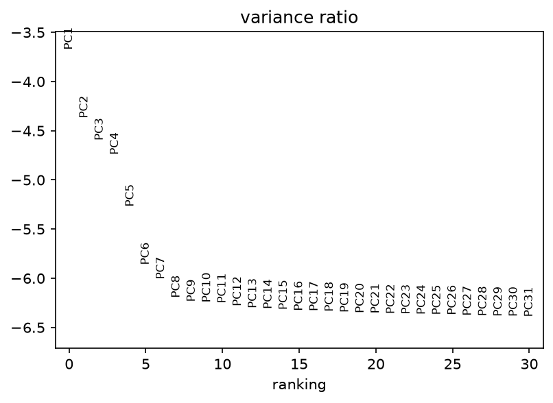
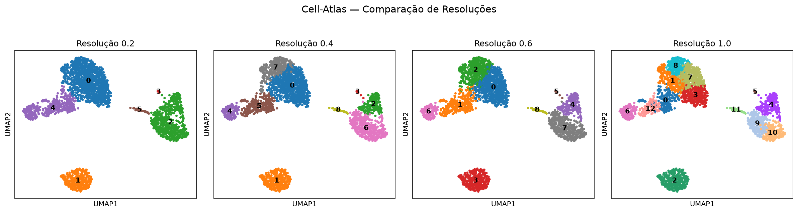
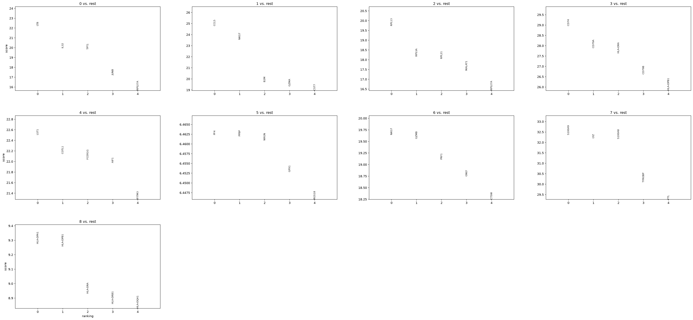
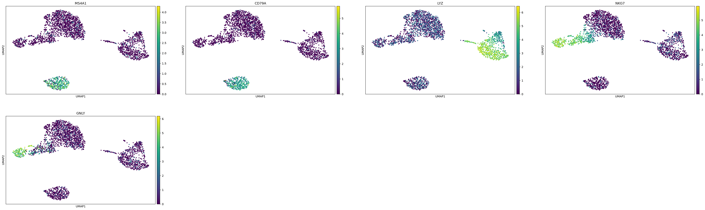

<div align="center">

# Cell-Atlas

[](https://github.com/rubenslyra/Cell-Atlas/releases/tag/v0.2.0)
[](https://www.python.org/)
[](https://scanpy.readthedocs.io/)
[](LICENSE)
[](https://rubenslyra.github.io/Cell-Atlas/)
[](https://semver.org/)
[](https://nvie.com/posts/a-successful-git-branching-model/)

**Construção de um Mapa Celular por Meio de Análise de Dados de Sequenciamento de RNA de Célula Única**

*Pipeline reprodutível, orientado a objetos e seguindo princípios SOLID para análise de scRNA-seq com o conjunto de referência PBMC3k.*

[Visão Geral](#-visão-geral) • [Arquitetura](#-arquitetura) • [Instalação](#-instalação) • [Execução](#-execução) • [Resultados](#-resultados) • [Documentação](#-documentação) • [Referências](#-referências)

</div>

---

## 🎯 Visão Geral

O **Cell-Atlas** implementa um fluxo completo e reprodutível para aquisição, controle de qualidade, pré-processamento, redução dimensional, agrupamento, visualização e anotação biológica de dados de *single-cell RNA sequencing* (scRNA-seq). 

Utilizando as **células mononucleares de sangue periférico humano (PBMC3k)** da 10x Genomics, o projeto demonstra a capacidade de separar populações celulares imunes conhecidas — linfócitos T, linfócitos B, monócitos e células NK — exclusivamente a partir de seus perfis transcricionais.

### Objetivos

1. **Reprodutibilidade** — Pipeline determinístico, documentado e rastreável seguindo boas práticas da comunidade scRNA-seq.
2. **Rigor metodológico** — Baseado em recomendações de Wolf et al. (2018), Traag et al. (2019) e Luecken & Theis (2019).
3. **Engenharia profissional** — Arquitetura OOP com princípios SOLID, padrões de projeto e design extensível/testável.
4. **Anotação biológica** — Identificação de tipos celulares via genes marcadores canônicos com validação visual por UMAP.

---

## 🏗 Arquitetura

A partir da versão `v0.2.0`, o projeto adota uma arquitetura modular em `src/`:

```text
Cell-Atlas/
├── src/cellatlas/           # Pacote principal (OOP + SOLID)
│   ├── core/                # Abstrações, interfaces, Config, Pipeline
│   ├── data/                # Estratégias de carregamento (PBMC3kLoader)
│   ├── analysis/            # Preprocessamento, Leiden, Anotação
│   ├── visualization/       # Componentes visuais
│   ├── utils/               # Logger, validadores, helpers
│   └── cli/                 # Interface CLI (entrypoint cellatlas)
├── scripts/                 # Scripts legados (compatibilidade)
├── docs/                    # GitHub Pages (index.html seguro + assets)
├── dados/                   # Dados brutos/processados
├── figuras/                 # Gráficos gerados
├── resultados/              # Tabelas e sumários
├── pyproject.toml           # Build, dependências e CLI
├── CHANGELOG.md             # Histórico (Keep a Changelog + SemVer)
└── ARTIGO_PROJETO.md        # Artigo acadêmico completo
```

### Princípios aplicados

- **SRP** (Single Responsibility Principle) — Cada classe tem uma única responsabilidade bem definida.
- **OCP** (Open/Closed Principle) — Extensível via interfaces, fechado para modificação.
- **LSP** (Liskov Substitution Principle) — Implementações intercambiáveis através de abstrações.
- **ISP** (Interface Segregation Principle) — Interfaces enxutas e específicas por função.
- **DIP** (Dependency Inversion Principle) — Dependência de abstrações, não de implementações concretas.
- **Padrões** — *Strategy*, *Composition*, *Dependency Injection*.

---

## ⚙️ Instalação

### Pré-requisitos

- Python `>= 3.9`
- pip atualizado
- Ambiente virtual (recomendado)

### Configuração

```bash
# Clonar repositório
git clone https://github.com/rubenslyra/Cell-Atlas.git
cd Cell-Atlas

# Criar e ativar ambiente virtual
python -m venv venv
# Windows
venv\Scripts\activate
# Linux/macOS
source venv/bin/activate

# Instalar dependências
pip install -r requisitos.txt

# (Opcional) Instalar pacote em modo desenvolvimento
pip install -e .
```

---

## 🚀 Execução

### Opção 1: Scripts modulares (direto)

Execute em ordem para reproduzir o pipeline completo:

```bash
python scripts/01_baixar_dados.py      # Aquisição - PBMC3k (10x Genomics)
python scripts/02_processar.py        # QC → Filtragem → Normalização → HVG → PCA
python scripts/03_agrupar.py          # k-NN → UMAP → Leiden (múltiplas resoluções)
python scripts/04_anotar.py           # Genes marcadores → Anotação biológica
```

### Opção 2: CLI unificado (após `pip install -e .`)

```bash
cellatlas download    # Baixar dataset
cellatlas preprocess  # Pré-processamento
cellatlas cluster     # Agrupamento Leiden + UMAP
cellatlas annotate    # Anotação por marcadores
cellatlas run-all     # Pipeline completo
```

---

## 📊 Resultados

O pipeline gera figuras e tabelas prontas para análise e publicação:

| Artefato | Descrição |
| --- | --- |
| `figuras/pca_variancia.png` | Variância explicada pelos componentes principais. |
| `figuras/umap_todas_resolucoes.png` | Comparação de resoluções Leiden (0.2, 0.4, 0.6, 1.0). |
| `figuras/genes_marcadores.png` | Top 5 genes diferencialmente expressos por cluster (Wilcoxon). |
| `figuras/marcadores_classicos.png` | Expressão de marcadores canônicos projetados em UMAP. |
| `resultados/resumo_grupos.csv` | Sumário com top genes e contagem por cluster (resolução 0.6). |

### Capturas de Tela

<div align="center">

#### Variância PCA


*Figura 1 — Variância explicada pelos 10 primeiros componentes principais.*

#### Comparação de Resoluções Leiden


*Figura 2 — Agrupamento Leiden em resoluções 0.2, 0.4, 0.6 e 1.0.*

#### Genes Marcadores por Cluster


*Figura 3 — Top 5 genes diferencialmente expressos por cluster (teste de Wilcoxon).*

#### Marcadores Canônicos em UMAP


*Figura 4 — Expressão de marcadores canônicos (CD3E, CD3D, TRAC, MS4A1, CD79A, CD14, LYZ, NKG7, GNLY) em projeção UMAP.*

</div>

### Sumário dos Clusters (Leiden 0.6)

| Grupo | Top Genes | Células | Interpretação (sugerida) |
| --- | --- | --- | --- |
| 0 | LTB, IL32, TPT1 | 711 | Linfócitos T |
| 1 | CCL5, NKG7, B2M | 315 | Linfócitos T citotóxicos / NK |
| 2 | RPL13, RPS3A, RPL21 | 438 | Células em alta atividade translacional |
| 3 | CD74, CD79A, HLA-DRA | 344 | Linfócitos B |
| 4 | LST1, COTL1, FCER1G | 206 | Monócitos/Macrófagos |
| 5 | PF4, PPBP, NRGN | 14 | Plaquetas |
| 6 | NKG7, GZMB, PRF1 | 142 | Células NK |
| 7 | S100A9, LYZ, S100A8 | 433 | Monócotos clássicos |
| 8 | HLA-DPA1, HLA-DPB1, HLA-DRA | 35 | Células apresentadoras de antígeno |

> *A anotação final deve ser realizada por comparação com literatura e conhecimento biológico. Os marcadores sugeridos servem as a referência inicial.*

---

## 📚 Documentação

- **[README.md](README.md)** — Visão geral, instalação, execução e resultados
- **[ARTIGO_PROJETO.md](ARTIGO_PROJETO.md)** — Artigo acadêmico completo com introdução, materiais e métodos, resultados e discussão
- **[CHANGELOG.md](CHANGELOG.md)** — Histórico de versões seguindo Keep a Changelog e SemVer
- **[GitHub Pages](https://rubenslyra.github.io/Cell-Atlas/)** — Documentação web interativa com simulação da resolução Leiden
- **[Releases](https://github.com/rubenslyra/Cell-Atlas/releases)** — Tags `v0.1.0` e `v0.2.0`

---

## 🤝 Contribuição

Contribuições são bem-vindas! Para manter a qualidade e o fluxo GitFlow:

1. Crie uma branch a partir de `develop`: `git checkout -b feature/sua-feature develop`
2. Faça commits semânticos e, preferencialmente, **assinados** (`git commit -S`)
3. Abra um *Pull Request* para `develop`
4. Aguarde revisão antes do merge

---

## 📝 Referências

- Wolf, F. A., Angerer, P. & Theis, F. J. SCANPY: large-scale single-cell gene expression data analysis. *Genome Biol.* 19, 15 (2018). [https://doi.org/10.1186/s13059-017-1382-0](https://doi.org/10.1186/s13059-017-1382-0)
- Traag, V. A., Waltman, L. & van Eck, N. J. From Louvain to Leiden: guaranteeing well-connected communities. *Sci. Rep.* 9, 5233 (2019). [https://doi.org/10.1038/s41598-019-41695-z](https://doi.org/10.1038/s41598-019-41695-z)
- Luecken, M. D. & Theis, F. J. Current best practices in single-cell RNA-seq analysis: a tutorial. *Mol. Syst. Biol.* 15, e8746 (2019). [https://doi.org/10.15252/msb.20188746](https://doi.org/10.15252/msb.20188746)
- Zheng, G. X. Y. et al. Massively parallel digital transcriptional profiling of single cells. *Nat. Commun.* 8, 14049 (2017). [https://doi.org/10.1038/ncomms14049](https://doi.org/10.1038/ncomms14049)
- 10x Genomics — *Official PBMC3k Dataset* ([https://www.10xgenomics.com/resources/datasets](https://www.10xgenomics.com/resources/datasets))

---

<div align="center">

**Cell-Atlas** — Mapeando a heterogeneidade celular com rigor computacional e biológico.

*Desenvolvido com fins acadêmicos e educacionais.*

[⬆ Voltar ao topo](#cell-atlas)

</div>
